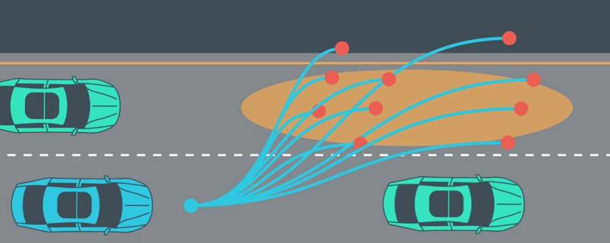
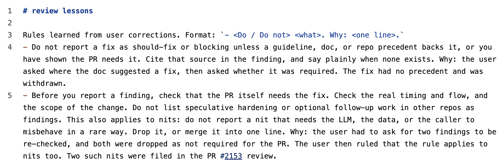

# Memory management for Coding Agents

## Contents

Introduction
Types of memory
Improving memory

## Introduction

### You're absolutely right!

https://absolutelyright.lol/

---

In the absence of information, AI makes decisions to the best of its capability, but this might differ from your product/decision requirement.

How do we get AI to make less mistakes ?
How can AI get to the correct state with minimal corrections ?

(Footnote: Source:https://medium.com/udacity/self-driving-path-planning-brought-to-you-by-udacity-students-13c07bcd4f32)

## What is memory

Acquire, store and retrieve information relevant for your tasks.

For Agent, it controls

- What the agent knows
- How it makes decisions
- How it implements code

---
4 types
Working
Episode
Semantic
Procedural

### Working

Context
AI agents provide tools for managing context - /compact, autocompaction, clear context, etc

### Episodic

conversation transcripts, session history, logs

Past sessions, past tasks, past failures

### Semantic

Semantic memory = facts and knowledge — what things are

ADR (Architecture Decision Record)
Incidents, Patterns

Tools: Mempalace ,Neo4J (graph)

### Procedural

Procedural memory = how to do things — skills, habits, learned procedures

how to deploy
how to review a PR
Agent skills

## How to improve memory

Curation !

A curation agent needs to learn from user interactions and make corrections.

I primarily execute my workflows with agent skills

What I do: 2 cronjobs
<!-- Good to add a flow chart / diagram for this -->

- A daily cronjob scans interactions, identifies "lessons", and stores "lessons.md" for each skill
- A weekly cronjob scans through the lessons, and suggests improvements to skills, and rules.

### Lessons

### Improvements

## Additional reading

https://www.langchain.com/blog/knowledge-factory
