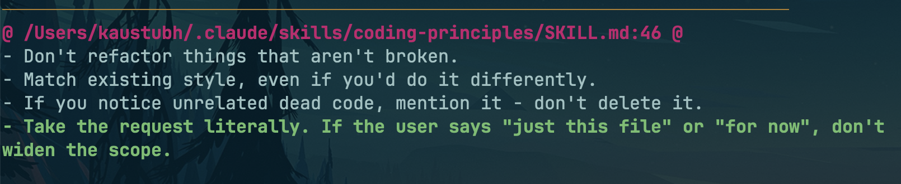
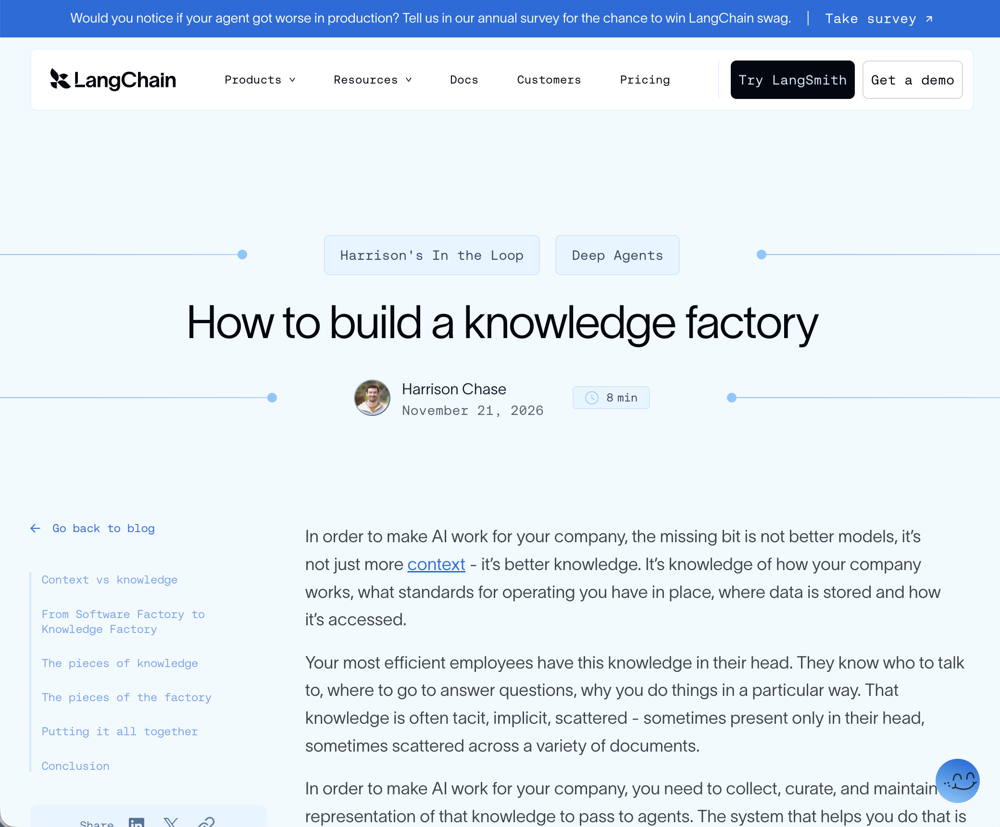

# Memory management for Coding Agents

## Contents

Introduction
Types of memory
Improving memory

## Introduction

### Kaustubh Hiware

Senior Software Engineer, Mercari Japan
𝕏 @_ofKaus

<!-- For AI: speaker profile slide, layout-intro from public-speaking-for-developers/talk. Needs images/kaustubh.jpg and images/qrcode.png -->

### You're absolutely right!

https://absolutelyright.lol/

---

In the absence of information, AI makes decisions to the best of its capability, but this might differ from your product/decision requirement.

How do we get AI to make less mistakes ?
How can AI get to the correct state with minimal corrections ?

(Footnote: Source:https://medium.com/udacity/self-driving-path-planning-brought-to-you-by-udacity-students-13c07bcd4f32)

## What is memory

Acquire, store and retrieve information relevant for your tasks.

For Agent, it controls

- What the agent knows
- How it makes decisions
- How it implements code

---
4 types
Working
Episode
Semantic
Procedural

We'll discuss who reads & writes each kind of memory.

---

### Platform support agent (PSA)

We'll walk through an example. Let's say we're building an agent that handles inquiries from engineers, investigates by itself, and assists incidents.

<!-- For AI, Add a good diagram to explain this, with a infinity loop kinda visual. Inputs are engineers, Pagerduty triggers, etc. Reads slack, memory, Datadog logs -->

### Working (W)

Context
AI agents provide tools for managing context - /compact, autocompaction, clear context, etc

- Only written by PSA, not read

### Episodic (E)

conversation transcripts, session history, logs

Past sessions, past tasks, past failures

- Only written by PSA

### Semantic (S)

Semantic memory = facts and knowledge — what things are

ADR (Architecture Decision Record)

Design decisions, features, API definitions

- Keep read only (written by humans or documentation agents)

Tools to explore: Mempalace, Neo4J (graph)

### Procedural (P)

Procedural memory = how to do things — skills, habits, learned procedures

how to deploy
how to review a PR
How the team works

- Written by humans & PSA

## How to improve memory

Curation !

A curation agent needs to learn from user interactions and make corrections. 

For Platform Support Agent, the Curation Agent

- Reads working, episodic memory (W, E)
- Curates patterns, incidents, new discovered systems
- Adds to procedural memory (P)

---
I primarily execute my workflows with agent skills

What I do: 2 cronjobs. Fully automated. Human approves behavioral changes. No approval for procedural knowledge.

- A daily cronjob scans interactions, identifies "lessons", and stores "lessons.md" for each skill
- A weekly cronjob scans through the lessons, and suggests improvements to skills, and rules.
<!-- For AI, Add a flow chart / diagram for this -->

### Lessons

### Improvements

## Additional reading

https://www.langchain.com/blog/knowledge-factory
